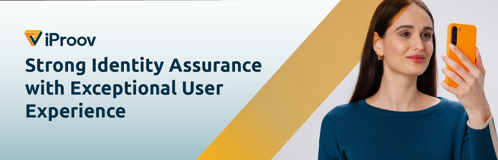

# iProov Face .NET MAUI SDK

## Introduction

The iProov .NET MAUI SDK lets you integrate iProov into your .NET MAUI, .NET for Android and .NET for iOS apps. It is distributed as three packages on nuget.org:

| Package | What it is | Guide |
|---|---|---|
| [iProov.NET.MAUI](https://www.nuget.org/packages/iProov.NET.MAUI/) | A unified .NET MAUI API over the iOS and Android SDKs | [iProov.NET.MAUI](iProov.NET.MAUI/README.md) |
| [iProov.NET.Android](https://www.nuget.org/packages/iProov.NET.Android/) | .NET bindings for the iProov Android SDK | [iProov.NET.Android](iProov.NET.Android/README.md) |
| [iProov.NET.iOS](https://www.nuget.org/packages/iProov.NET.iOS/) | .NET bindings for the iProov iOS SDK | [iProov.NET.iOS](iProov.NET.iOS/README.md) |

Most apps only need iProov.NET.MAUI, which brings in the other two.

## Repository Contents

This repository contains the following:

* **ExampleAppMAUI** - A basic .NET MAUI app using iProov.NET.MAUI and the API client.
* **APIClient** - The source code of a .NET client for iProov's REST API v2, used by the example app to get tokens.
* **iProov.NET.MAUI**, **iProov.NET.Android**, **iProov.NET.iOS** - The integration guide for each package, also shown on its nuget.org page.
* **dotnet-maui.sln** - A solution containing the example app and the API client.

## Upgrading from Earlier Versions

If you're already using an older version of the SDK, see [Upgrading from 3.x](iProov.NET.MAUI/README.md#upgrading-from-3x) in the iProov.NET.MAUI guide.

## Registration

You can obtain API credentials by registering on the [iProov Portal](https://portal.iproov.com/).

## Example Project

For a simple iProov experience that is ready to run out-of-the-box, check out [ExampleAppMAUI](ExampleAppMAUI), a .NET MAUI app that integrates iProov.NET.MAUI and uses the API client to get tokens. It needs the same tools as the packages: see [Requirements](iProov.NET.MAUI/README.md#requirements) in the iProov.NET.MAUI guide.

### Installation

1. In the `ExampleAppMAUI` folder, copy `Credentials.example.cs` to `Credentials.cs` and update it with your API key, secret and URLs. You can obtain these credentials from the [iProov Portal](https://portal.iproov.com/).

2. Open `dotnet-maui.sln`, then build and run the `ExampleAppMAUI` project on a real device.

> **Warning**: The example app uses the API client to directly fetch tokens on-device and this is inherently insecure. Production implementations of iProov should always obtain tokens securely from a server-to-server call.

## API Client

The [APIClient](APIClient) project is a simple wrapper for iProov's REST API v2, written in C#, which the example app uses to get tokens. It needs your API secret, so use it only for testing, debugging and demos, never in a production app. You could also adapt it to run on your back-end for server-to-server calls.

It supports the following functionality:

- `GetToken()` - Get an enrol/verify token.
- `EnrolPhoto()` - Perform a photo enrolment (either from an electronic or optical image). The image must be provided in JPEG format.
- `Validate()` - Validate an existing token against the provided User ID.
- `EnrolPhotoAndGetVerifyToken()` - A convenience method which first gets an enrolment token, then enrols the photo against that token, and then gets a verify token for the user to iProov against.

## Help & Support

See the [release notes](https://github.com/iProov/dotnet-maui/releases) for the changes in each version.

For help with integrating the SDK, please contact [support@iproov.com](mailto:support@iproov.com).
